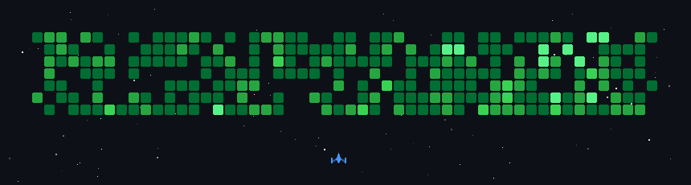

# _Hi, I'm Radhi._

## _About Me_

Computer science student and software engineer. I like building the small, fast version of things that already exist, then self-hosting it on hardware that can't afford to be wasteful.

Most of what I write ends up in Go, Java, or plain HTML and CSS. I care a lot about software that stays out of the way.

## _What I'm Building_

**[ai-ui](https://github.com/bajahaw/ai-ui)** — a lightweight, self-hosted AI chat with MCPs and skills support. I learned Go to build it after every other chat UI ate my server alive. It has been my daily driver for over a year.

## _Writing_

I keep notes on what I build at **[bajahaw.com/blogs](https://bajahaw.com/blogs/)**, including [why I built my own AI chat](https://bajahaw.com/blogs/better-ai-chat.html).

## Socials

## Tech Stack

## GitHub Stats

<a href="https://next.ossinsight.io/widgets/official/compose-user-dashboard-stats?user_id=153525225" target="_blank" align="center">
  <picture>
    <source media="(prefers-color-scheme: dark)" srcset="https://next.ossinsight.io/widgets/official/compose-user-dashboard-stats/thumbnail.png?user_id=153525225&image_size=auto&color_scheme=dark" width="50%" height="auto">
    
  </picture>
</a>

<a href="https://next.ossinsight.io/widgets/official/compose-currently-working-on?user_id=153525225&activity_type=all" target="_blank" align="center">
  <picture>
    <source media="(prefers-color-scheme: dark)" srcset="https://next.ossinsight.io/widgets/official/compose-currently-working-on/thumbnail.png?user_id=153525225&activity_type=all&image_size=auto&color_scheme=dark" width="49%" height="auto">
    
  </picture>
</a>

Always happy to collaborate or just talk shop — my inbox is open.

